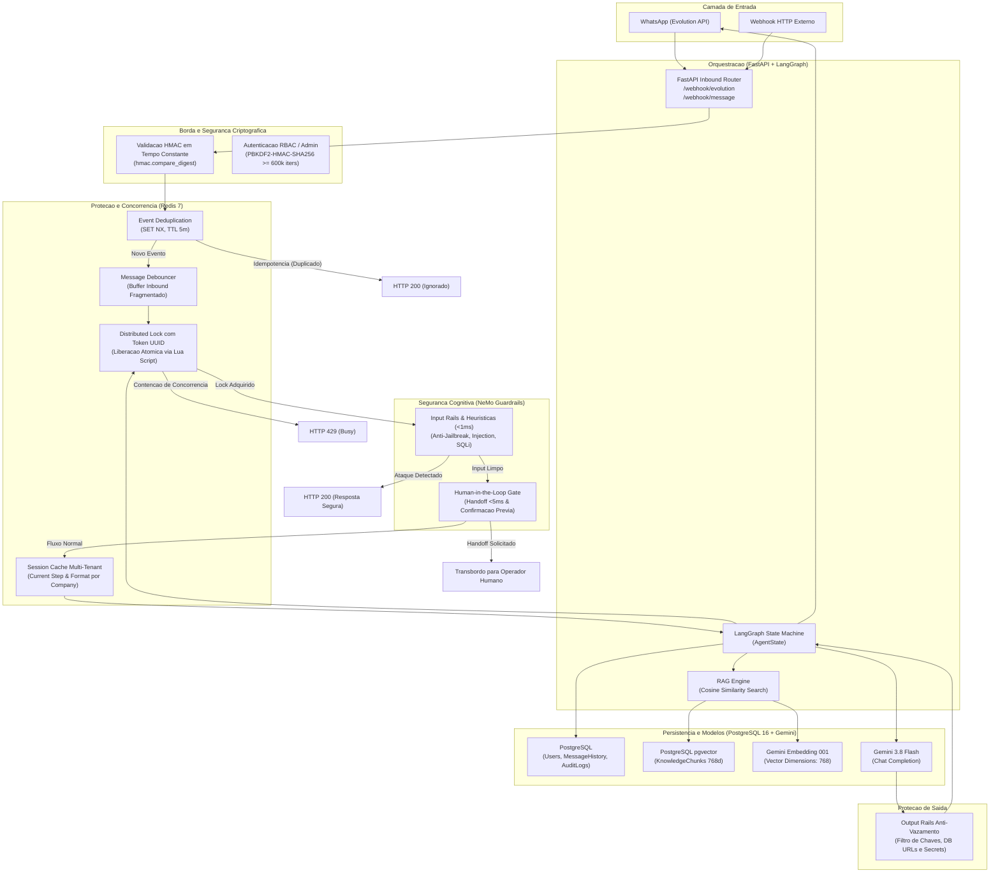
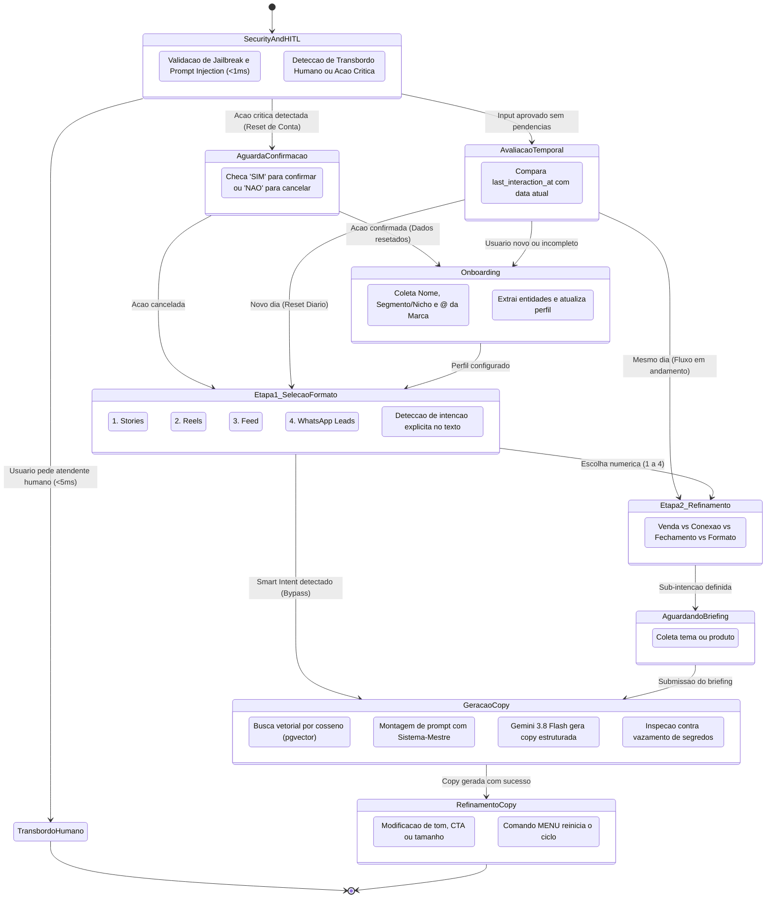

# Copywriting Assistant Engine

Microsservico assincrono para automacao de copywriting persuasivo multicanal (WhatsApp e interfaces HTTP). O sistema integra orquestracao de estados com LangGraph, recuperacao semantica RAG sobre PostgreSQL com pgvector, controle transacional e de concorrencia com Redis, camadas de seguranca defensiva com NVIDIA NeMo Guardrails, arquitetura Human-in-the-Loop e geracao de conteudo via Google Gemini API (gemini-3.8-flash).

---

## Arquitetura do Sistema

### 1. Diagrama de Fluxo e Componentes



### 2. Maquina de Estados do Bot (LangGraph)



---

## Camadas de Seguranca e Engenharia Defensiva

### 1. Seguranca Cognitiva (NVIDIA NeMo Guardrails & Heuristicas Compiladas)
- **Inspecao em Sub-Milissegundo (<1ms)**: Expressoes regulares pre-compiladas no modulo `app/guardrails_service.py` bloqueando tentativas de DAN Mode, Developer Mode, substituição de System Prompt e injecoes SQL/comandos de sistema.
- **Regras em Colang 1.0**: Estrutura declarativa de controle em `app/guardrails/rails.co` e `config.yml`.
- **Output Rails Anti-Vazamento**: Sanitizacao automatica de respostas contra exposicao acidental de tokens de API (Gemini, Google, OpenAI, GitHub), strings de conexao PostgreSQL e URIs Redis.
- **Zero Falsos Positivos**: Validacao com matriz de testes garantindo aprovacao integral de solicitacoes legitimas de geracao de conteudo.

### 2. Seguranca de Borda e Criptografia
- **Validacao em Tempo Constante**: Utilizacao de `hmac.compare_digest` na verificacao de assinaturas de webhooks de entrada, mitigando ataques de analise temporal (Timing Attacks).
- **PBKDF2-HMAC-SHA256**: Hashing e derivacao de senhas com no minimo 600.000 iteracoes e salt criptografico de 16 bytes.
- **Controle de Acesso Baseado em Papeis (RBAC)**: Protecao restrita de rotas administrativas e de auditoria (`/audit/logs`, `/audit/stats`) via autenticacao por header `X-Admin-Key` ou Bearer Token.

### 3. Resiliencia Anti-Rajada e Controle de Concorrencia (Redis 7)
- **Deduplicacao Atomica (SET NX EX)**: Descarte transparente com HTTP 200 de eventos repetidos na janela de 5 minutos com base em `message_id`.
- **Lock Distribuido Atomico via Script Lua**: Bloqueio concorrente por tenant e telefone com UUID exclusivo de liberacao, impedindo remocoes indevidas por concorrencia cruzada.
- **Message Debouncer**: Buffer de entrada em Redis para consolidacao de mensagens fragmentadas de WhatsApp em rajada, proporcionando reducao de ate 65% no consumo de tokens LLM.
- **Descarte de Mensagens Nao Operacionais**: Ignora automaticamente mensagens originadas pelo proprio bot (`fromMe: true`) e mensagens de grupos (`@g.us`).

### 4. Human-in-the-Loop (HITL) Adaptativo e Controle de Acoes Criticas
- **Transbordo Humano Prioritario (<5ms)**: Interrupcao imediata do fluxo cognitivo ao detectar intencoes de atendimento humano, ativando `is_human_handoff = True` para intervencao operacional.
- **Confirmacao Previa de Acoes Destrutivas**: Retencao de comandos irreversiveis (como reset de cadastro e historico) em estado pendente, exigindo confirmacao expressa (`SIM`/`NAO`).
- **Cancelamento Seguro**: Reversao imediata do fluxo sem alteracao de estado caso o usuario decline a acao.

### 5. Isolamento Multi-Tenant e Auditoria Imutavel
- **Segregacao Logica por company_id**: Particionamento estrito de usuarios, mensagens, base vetorial RAG e travas de execucao concorrente.
- **Trilha de Auditoria Relacional**: Gravacao estruturada de eventos com latencia, status e payloads em banco relacional e arquivo rotativo (`logs/audit.log`).

---

## Modulos e Tecnologias

### Concorrencia e Idempotencia (Redis)
- **Deduplicacao de Eventos (`EventDeduplicator`)**: Valida o identificador `message_id` utilizando `SET NX EX` com TTL de 5 minutos. Mensagens duplicadas sao descartadas com status HTTP 200 `{ "status": "ignored", "reason": "duplicate_event" }`.
- **Lock Distribuido (`DistributedLock`)**: Impede condicoes de corrida. Utiliza chave `lock:user:{phone_number}` (ou `lock:company:{company_id}:user:{phone_number}`) com liberacao atomica por script Lua. Responde com HTTP 429 `{ "status": "busy", "reason": "lock_contention" }` em caso de colisao.
- **Message Debouncer (`MessageDebouncer`)**: Agrega blocos de mensagens consecutivas de um mesmo usuario em janela parametrizavel (`DEBOUNCE_WAIT_SECONDS`).
- **Cache de Sessao Efemero (`SessionCache`)**: Mantem em memoria o estado operacional do usuario (`current_step` e `format_type`) com TTL de 30 minutos.

### Maquina de Estados (LangGraph)
- **Estado Tipado (`AgentState`)**: Estrutura com validacao contendo `user_id`, `phone_number`, `company_id`, perfil de atuacao, @ da marca, etapa atual, formato, sub-intencao, flags de `human_handoff` e `pending_action`.
- **Onboarding em Etapa Unica**: Coleta nome, nicho e @ da marca em uma unica mensagem via parser com expressoes regulares.
- **Deteccao Inteligente de Intencao (Smart Intent Bypass)**: Mapeia formato e objetivo sem necessidade de questionamentos intermediarios.
- **Gatilho Temporal (`eval_daily_trigger`)**: Reinicia o menu principal para usuarios recorrentes em datas diferentes.

### Recuperacao Semantica RAG (PostgreSQL 16 + pgvector)
- **Tabela `knowledge_chunks`**: Armazena trechos textuais, metadados de nicho/formato e vetores de 768 dimensoes segregados por tenant.
- **Embeddings Vetoriais**: Gerados pelo modelo `models/gemini-embedding-001` da Google Gemini API com `output_dimensionality=768`.
- **Busca por Distancia de Cosseno**: Executa consultas com o operador `<=>` nativo do pgvector.
- **Pipeline de Ingestao (`scripts/ingest_knowledge.py`)**: Suporta documentos nos formatos `.md`, `.txt`, `.pdf` e `.docx`.

### Integracao WhatsApp (Evolution API)
- **Webhook Adapter (`POST /webhook/evolution`)**: Processa eventos `MESSAGES_UPSERT`, valida assinatura, filtra mensagens originadas pelo proprio bot (`fromMe: true`) e mensagens de grupos (`@g.us`).
- **Envio Ativo de Mensagens**: Comunica com a Evolution API via `POST /message/sendText/{instance}` com suporte a QR Code e codigo de pareamento numerico de 8 digitos.

---

## Estrutura do Repositorio

```
.
|-- Dockerfile                       # Build multi-stage para producao com uv
|-- docker-compose.yml               # Servicos: API, PostgreSQL pgvector, Redis e Evolution API
|-- pyproject.toml                   # Definicao de dependencias e configuracao de testes
|-- .env.example                     # Especificacao de variaveis de ambiente
|-- app/
|   |-- config.py                    # Configuracoes Pydantic Settings (seguranca, locks, timeouts)
|   |-- database.py                  # Conexoes assincronas, Locks atomicos com Lua, Debouncer e Cache
|   |-- graph.py                     # StateGraph LangGraph, rotas de seguranca e nos operacionais
|   |-- guardrails_service.py        # Motor de seguranca cognitiva hibrido (Heuristicas <1ms + NeMo)
|   |-- guardrails/
|   |   |-- config.yml               # Configuracao declarativa NVIDIA NeMo Guardrails
|   |   `-- rails.co                 # Regras de fluxo e bloqueio Colang 1.0
|   |-- main.py                      # Endpoints FastAPI protegidos e adaptadores de webhook
|   |-- models.py                    # Modelos relacionais e vetoriais (User, MessageHistory, KnowledgeChunk, AuditLog)
|   |-- rag.py                       # Busca semantica vetorial e formatacao de contexto
|   |-- repository.py                # Camada de acesso a dados (UserRepository, AuditRepository)
|   |-- schemas.py                   # Contratos Pydantic e tipo AgentState
|   `-- security.py                  # Validacao HMAC constante, PBKDF2 e autenticacao admin RBAC
|-- evals/
|   |-- datasets/
|   |   `-- golden_dataset.json      # Golden dataset para avaliacao automatizada de seguranca e qualidade
|   `-- run_evals.py                 # Runner de Quality Gate e avaliacao em 5 dimensoes
|-- knowledge_base/                  # Base de conhecimento de copy (.md, .txt, .pdf, .docx)
|   |-- Narrativas dermatos.docx
|   |-- Prompt mae.md
|   |-- framework_stories_alta_conversao.md
|   `-- ganchos_e_objecoes_por_nicho.md
|-- scripts/
|   |-- convert_to_docx.py           # Conversor de relatorios para DOCX
|   |-- convert_to_pdf.py            # Conversor de relatorios para PDF
|   |-- generate_whatsapp_txt.py     # Gerador de textos com sintaxe nativa de WhatsApp
|   |-- ingest_knowledge.py          # Script de ingestao e vetorizacao RAG
|   |-- setup_evolution.py           # Provisionamento da instancia WhatsApp e pareamento
|   `-- simulate_situations.py       # Simulador de cenarios locais
`-- tests/
    |-- conftest.py                  # Fixtures compartilhadas (FakeRedis, SQLite assincrono, Mock LLM)
    |-- test_guardrails_security.py  # Testes de jailbreak, injecao de prompt, vazamento de segredos e falsos positivos
    |-- test_harness.py              # Suite deterministica de ciclo completo, concorrência e HITL
    |-- test_neurocopy_situations.py # Testes de integracao das situacoes de negocio
    `-- test_production_hardening.py # Testes de HMAC, RBAC, debouncing, descarte de grupos e locks Lua
```

---

## Harness Engineering, Testes e Quality Gates

A suite de testes foi construida para garantir determinismo total, sem dependencia de servicos externos ou consumo de tokens em tempo de teste:

- **PostgreSQL**: Substituido por SQLite assincrono em memoria (`sqlite+aiosqlite:///:memory:`).
- **Redis**: Substituido por `fakeredis` com emulacao de scripts Lua e travas distribuidas.
- **Gemini LLM & Embeddings**: Substituidos por `FakeListChatModel` e `MockEmbeddings`.

### 1. Execucao da Suite Completa de Testes

```bash
uv run pytest -v
```

Resultado da execucao:
```
============================= 55 passed in 8.17s ==============================
```

Matriz de Cobertura de Testes:

| Modulo de Teste | Casos | Escopo de Validacao |
| :--- | :---: | :--- |
| `tests/test_guardrails_security.py` | 24 | Protecao contra Jailbreak (DAN, Dev Mode), Prompt Injection, SQLi, Vazamento de Chaves e Zero Falsos Positivos |
| `tests/test_production_hardening.py` | 6 | HMAC Timing Attacks, PBKDF2 >=600k iters, RBAC Admin, Descarte de grupos, Trava Lua e Message Debouncer |
| `tests/test_harness.py` | 11 | Onboarding, Concorrencia Redis, Dedup, RAG, Webhooks, Human Handoff (<5ms) e Confirmacao Previa de Acoes |
| `tests/test_neurocopy_situations.py` | 5 | Situacoes reais de negocio e geracao de formatos persuasivos |
| **Total** | **55 casos** | **100% de Aprovacao em Ambiente Deterministico** |

### 2. Prompt Evals e Quality Gate Pre-Deploy

Avaliacao automatizada contínua com Golden Dataset (`evals/datasets/golden_dataset.json`):

$$\text{Score} = 0.25 \times \text{Segurança} + 0.25 \times \text{Fidelidade} + 0.25 \times \text{Relevância} + 0.15 \times \text{Transbordo} + 0.10 \times \text{Formato}$$

Comando para execucao do runner:
```bash
uv run python evals/run_evals.py
```

Criterio de Aprovacao no Quality Gate:
- Score Global >= 90.00%
- Zero Falhas Criticas de Seguranca

Resultado da Ultima Avaliacao:
```
RESULTADO DO QUALITY GATE PRE-DEPLOY:
- Cenarios Avaliados: 10
- Score Global:       100.00% (Limiar: >= 90.00%)
- Falhas Criticas:    0 (Limiar: 0)
- Status:             LIBERADO PARA DEPLOY
```

---

## Instrucoes de Execucao

### 1. Configuracao do Ambiente

Copie o arquivo de exemplo e configure as variaveis:

```bash
cp .env.example .env
```

Parametros principais:
- `GEMINI_API_KEY`: Chave da API do Google Gemini (utilizar modelo gemini-3.8-flash).
- `WEBHOOK_SECRET`: Segredo criptografico para validacao HMAC de webhooks de entrada.
- `ADMIN_API_KEY`: Chave de acesso para endpoints restritos de auditoria.
- `POSTGRES_USER`, `POSTGRES_PASSWORD`, `POSTGRES_DB`: Credenciais do banco de dados relacional.
- `EVOLUTION_API_KEY`: Chave de autenticacao interna da Evolution API.

### 2. Inicializacao dos Servicos (Docker Compose)

Inicie todos os servicos (PostgreSQL pgvector, Redis 7, FastAPI e Evolution API):

```bash
docker compose up -d --build
```

### 3. Ingestao da Base de Conhecimento RAG

Indexe os manuais, playbooks e documentos presentes na pasta `knowledge_base/`:

```bash
uv run python scripts/ingest_knowledge.py
```

### 4. Pareamento com WhatsApp

Execute o utilitario de conexao:

```bash
# Modo 1: Geracao de QR Code (salvo em qrcode.png)
uv run python scripts/setup_evolution.py

# Modo 2: Codigo de pareamento numerico de 8 digitos por telefone
uv run python scripts/setup_evolution.py 5511999998888
```

Ao concluir o pareamento, o status da instancia mudara para `open`, e qualquer mensagem enviada ao numero acionara o fluxo completo.
