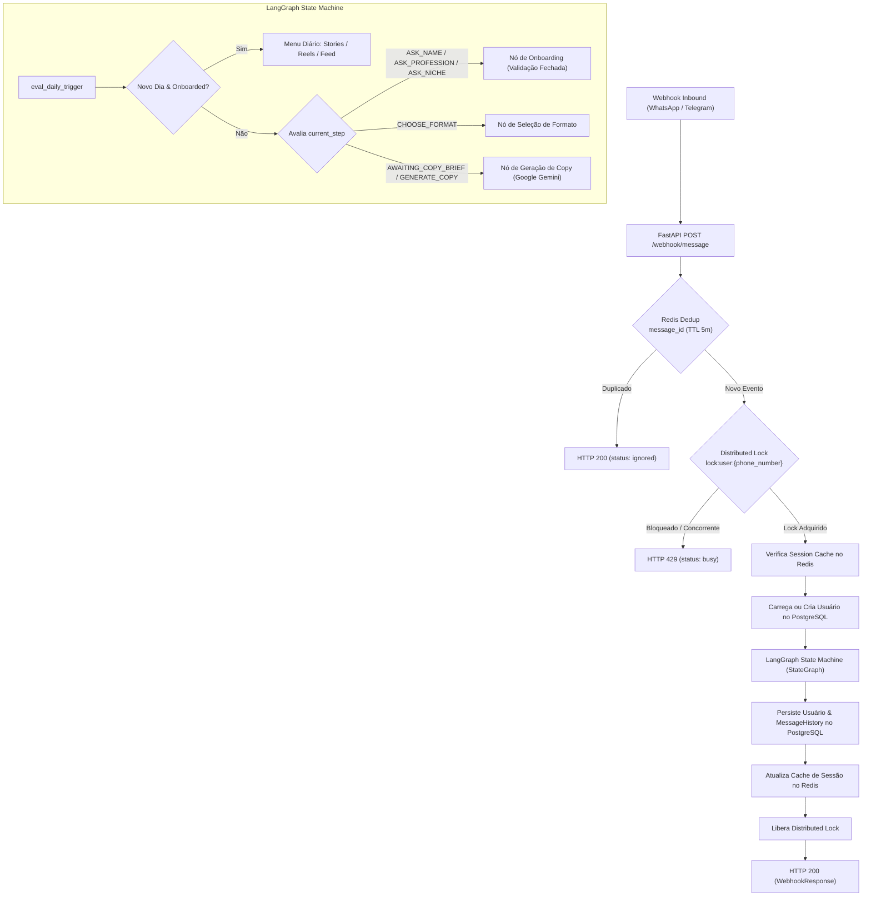

# Core de Bot de Copywriting de Alta Conversão (WhatsApp / Telegram)

Arquitetura de microsserviço de alta performance para chatbots de copywriting persuasivo, construído com **FastAPI**, **LangChain / LangGraph**, **PostgreSQL** (SQLAlchemy 2.0 Async), **Redis** (Lock distribuído, Deduplicação e Cache efêmero) e **Google Gemini API**, acompanhado por um **Test Harness** 100% determinístico e automatizado.

---

## 🏛️ Visão Geral da Arquitetura



---

## 🚀 Camadas do Sistema

### 1. Concorrência e Deduplicação (Redis)
- **Deduplicação de Eventos (`EventDeduplicator`)**:
  - Armazena a chave `dedup:msg:{message_id}` com TTL de 5 minutos utilizando comando atômico `SET NX EX`.
  - Se um webhook reenviar a mesma mensagem (política de retry de mensageria), o sistema ignora o reprocessamento imediatamente com HTTP 200 e payload `{ status: "ignored", reason: "duplicate_event" }`.
- **Lock Distribuído (`DistributedLock`)**:
  - Lock atômico por `phone_number` com lease timeout de 10s e timeout de bloqueio de 2s.
  - Impede race conditions causadas por múltiplos cliques rápidos ou rajadas de mensagens no WhatsApp, respondendo com HTTP 429 controlado (`status: busy, reason: lock_contention`).
- **Cache de Sessão Efêmero (`SessionCache`)**:
  - Chaves `session:step:{phone}` e `session:format:{phone}` com TTL de 30 minutos, acelerando leituras ativas sem sobrecarregar o PostgreSQL.

### 2. Máquina de Estados Finita e Orquestração (LangGraph)
- **`AgentState` Tipado**: Mantém `user_id`, `phone_number`, `name`, `profession`, `niche`, `current_step`, `format_type`, `last_interaction_at`, `messages`, etc.
- **Onboarding Determinístico com Validação Fechada**:
  - Passo 1: Nome do usuário.
  - Passo 2: Profissão / Atuação.
  - Passo 3: Menu fechado de nichos (1 a 5). Se o input for inválido, o nó **não transita de estado** e devolve erro controlado.
- **Nó Temporal (`eval_daily_trigger`)**:
  - Compara `last_interaction_at::date` com a data do evento recebido.
  - Se for um novo dia e o onboarding estiver concluído, transita obrigatoriamente para a seleção de formato ("O que quer criar hoje? 1. Stories, 2. Reels, 3. Feed").
  - Se for no mesmo dia, preserva e continua o fluxo de criação/refinamento de copy.
- **Nó de Copywriting de Alta Conversão (`generate_copy`)**:
  - Injeta obrigatoriamente `{name}`, `{profession}`, `{niche}` e `{format_type}` em prompt especializado de resposta direta (AIDA/PAS, ganchos magnéticos, quebra de objeções e CTA).
  - Executa chamada assíncrona ao Google Gemini (`ChatGoogleGenerativeAI`) ou mock nos testes.

### 3. Persistência Relacional & RAG Vetorial (PostgreSQL 16 + pgvector)
- **Tabela `users`**: Armazena identidade (UUID PK), telefone com índice único, dados cadastrais, `current_step`, `format_type` ativo, timestamps timezone-aware.
- **Tabela `message_history`**: Log transacional de todas as mensagens (humano e assistente), vinculada por FK com índice composto `(user_id, created_at)`.
- **Tabela `knowledge_chunks` (pgvector)**: Base de conhecimento de copywriting indexada com vetores de 768 dimensões gerados pela Google Gemini API (`models/gemini-embedding-001`), permitindo busca semântica por similaridade de cosseno com filtros de metadados (`niche` e `format_type`).
- **Repositório Assíncrono (`UserRepository`) & Módulo RAG (`app/rag.py`)**: Isola completamente queries, buscas vetoriais e injeção contextual no prompt.

### 4. Harness Engineering & Testes Automatizados (Pytest)
- **Isolamento 100% Determinístico**:
  - SQLite assíncrono in-memory (`sqlite+aiosqlite:///:memory:`) substitui o PostgreSQL nos testes (com suporte a colunas Vector sem dependência externa).
  - `fakeredis` com suporte a scripts Lua substitui o Redis sem necessidade de container rodando.
  - `FakeListChatModel` e `MockEmbeddings` interceptam e validam chamadas de LLM e Embeddings com zero tráfego de rede e custo zero de tokens.
- **Bateria de Testes Cobrindo (8 testes)**:
  1. Ciclo completo de onboarding até o estado de escolha de formato.
  2. Rejeição de input inválido no menu fechado de nichos.
  3. Simulação de mensagens no mesmo dia vs. dia subsequente (disparo do menu de formatos).
  4. Validação de contenção do Distributed Lock do Redis contra concorrência.
  5. Deduplicação idempotente de eventos de webhook repetidos.
  6. Injeção de variáveis de perfil no prompt e geração da copy formatada.
  7. Adaptador de webhook do Evolution API (WhatsApp) com filtro de mensagens do bot e grupos.
  8. Busca semântica e injeção de contexto RAG da base de conhecimento no prompt.

---

## 📂 Estrutura de Arquivos

```
.
├── Dockerfile                  # Imagem de produção multi-stage otimizada com uv
├── docker-compose.yml          # Orquestração: PostgreSQL 16 (pgvector), Redis 7, API e Evolution API
├── pyproject.toml              # Dependências e configuração do pytest/asyncio
├── .env.example                # Template de variáveis de ambiente
├── app/
│   ├── __init__.py
│   ├── config.py               # Pydantic Settings para variáveis de ambiente
│   ├── database.py             # Engine SQLAlchemy Async, pgvector, Redis, Lock, Dedup e SessionCache
│   ├── models.py               # Modelos SQLAlchemy 2.0 (User, MessageHistory, KnowledgeChunk)
│   ├── rag.py                  # Módulo RAG: busca semântica no pgvector e formatação de contexto
│   ├── schemas.py              # Contratos Pydantic (WebhookEvent, WebhookResponse) e AgentState
│   ├── repository.py           # Repositório assíncrono para usuários e mensagens
│   ├── graph.py                # StateGraph LangGraph com injeção de RAG e prompt de alta conversão
│   └── main.py                 # FastAPI: /webhook/message, /webhook/evolution e envio WhatsApp
├── knowledge_base/             # Manuais, playbooks e frameworks de copy (.md, .txt, .pdf)
│   ├── framework_stories_alta_conversao.md
│   └── ganchos_e_objecoes_por_nicho.md
├── scripts/
│   ├── ingest_knowledge.py     # Ingestão de arquivos da knowledge_base no PostgreSQL pgvector
│   └── setup_evolution.py      # Automação de criação de instância WhatsApp, webhook e QR Code
└── tests/
    └── test_harness.py         # Suíte de testes determinísticos automatizados (8 testes)
```

---

## 🛠️ Como Executar

### 1. Clonar e Instalar Dependências (via `uv`)
```bash
# Sincronizar ambiente virtual
uv sync
```

### 2. Rodar a Bateria de Testes Automatizados (Harness Engineering)
```bash
uv run pytest -v
```

Saída esperada:
```
tests/test_harness.py::test_full_onboarding_cycle PASSED                 [ 12%]
tests/test_harness.py::test_niche_invalid_input_rejection PASSED         [ 25%]
tests/test_harness.py::test_same_day_vs_subsequent_day_temporal_trigger PASSED [ 37%]
tests/test_harness.py::test_redis_distributed_lock_concurrency PASSED    [ 50%]
tests/test_harness.py::test_redis_event_deduplication PASSED             [ 62%]
tests/test_harness.py::test_copy_generation_prompt_injection PASSED      [ 75%]
tests/test_harness.py::test_evolution_webhook_adapter PASSED             [ 87%]
tests/test_harness.py::test_rag_semantic_knowledge_injection PASSED      [100%]
============================== 8 passed in 5.69s ==============================
```

### 3. Subir com Docker Compose (PostgreSQL com pgvector + Redis + API + Evolution API)
```bash
# Subir infraestrutura completa em segundo plano
docker compose up -d --build
```

### 4. Ingestão de Documentos na Base de Conhecimento RAG
Para indexar os playbooks e materiais de copy enviados pela sua equipe na pasta `knowledge_base/`:
```bash
uv run python scripts/ingest_knowledge.py
```

### 5. Conectar seu WhatsApp (100% Gratuito via Evolution API)
Execute o script utilitário para provisionar a instância, registrar o webhook interno e gerar o QR Code:
```bash
uv run python scripts/setup_evolution.py
```
A imagem `qrcode.png` será gerada na raiz do projeto. Basta abrir o WhatsApp no seu smartphone e escanear em:
`Aparelhos conectados > Conectar um aparelho`.
