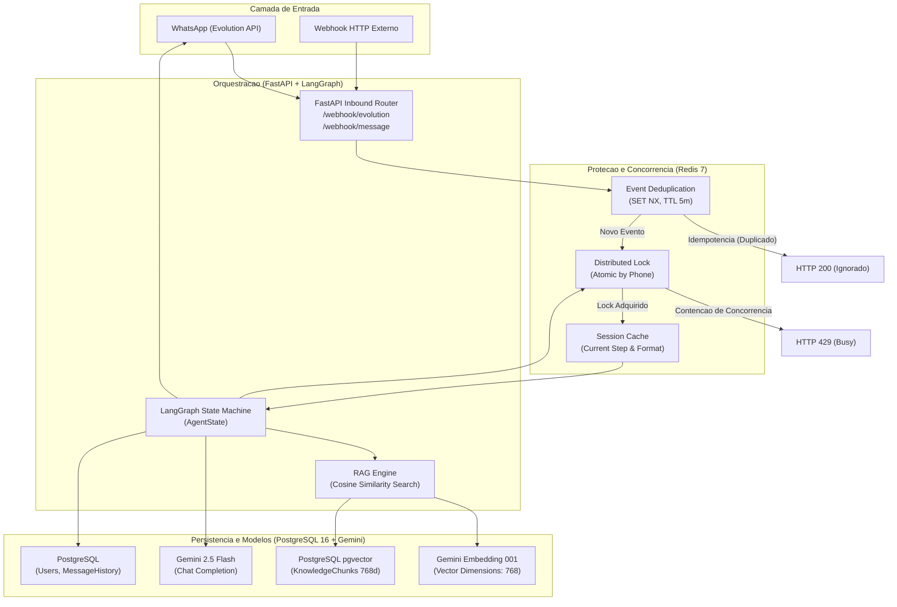
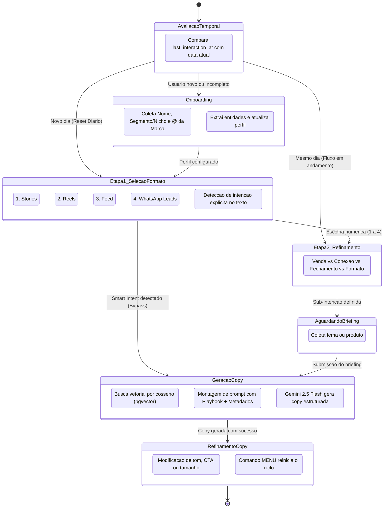

# Copywriting Assistant Engine

Microsserviço assíncrono para automação de copywriting persuasivo multicanal (WhatsApp e interfaces HTTP). O sistema integra orquestração de estados com LangGraph, recuperação semântica RAG sobre PostgreSQL com pgvector, controle transacional e de concorrência com Redis, e geração de conteúdo via Google Gemini API.

---

## Arquitetura do Sistema

### 1. Diagrama de Fluxo e Componentes



### 2. Maquina de Estados do Bot (LangGraph)



---

## Modulos e Tecnologias

### Concorrencia e Idempotencia (Redis)
- **Deduplicacao de Eventos (`EventDeduplicator`)**: Valida o identificador `message_id` utilizando `SET NX EX` com TTL de 5 minutos. Mensagens duplicadas provenientes de retentativas de webhook sao descartadas com status HTTP 200 `{ "status": "ignored", "reason": "duplicate_event" }`.
- **Lock Distribuido (`DistributedLock`)**: Impede condicoes de corrida causadas por mensagens simultaneas do mesmo remetente. Utiliza chave `lock:user:{phone_number}` com lease timeout de 10 segundos e timeout de bloqueio de 2 segundos. Em caso de colisao, responde com HTTP 429 `{ "status": "busy", "reason": "lock_contention" }`.
- **Cache de Sessao Efemero (`SessionCache`)**: Mantem em memoria o estado operacional do usuario (`current_step` e `format_type`) com TTL de 30 minutos para reduzir a carga de leitura no PostgreSQL.

### Maquina de Estados (LangGraph)
- **Estado Tipado (`AgentState`)**: Estrutura com validacao contendo identificador do usuario, numero de telefone, perfil de atuacao, @ da marca, etapa atual, formato, sub-intencao, timestamps e contexto RAG recuperado.
- **Onboarding em Etapa Unica**: Coleta nome, nicho e @ da marca em uma unica mensagem via parser com expressoes regulares, eliminando a friccao de formularios sequenciais.
- **Deteccao Inteligente de Intencao (Smart Intent Bypass)**: Analisa mensagens com explicacoes livres (ex: *"Quero um carrossel para o feed sobre harmonizacao"*), mapeia automaticamente formato e objetivo, e pula a Etapa 2 diretamente para a geracao.
- **Gatilho Temporal (`eval_daily_trigger`)**: Reinicia o menu principal para usuarios recorrentes em datas diferentes, preservando o contexto em interacoes no mesmo dia.

### Recuperacao Semantica RAG (PostgreSQL 16 + pgvector)
- **Tabela `knowledge_chunks`**: Armazena trechos textuais, metadados de nicho/formato e vetores de 768 dimensoes.
- **Embeddings Vetoriais**: Gerados pelo modelo `models/gemini-embedding-001` da Google Gemini API com `output_dimensionality=768`.
- **Busca por Distancia de Cosseno**: Executa consultas com o operador `<=>` nativo do pgvector, filtrando por nicho e formato com fallback gracioso.
- **Pipeline de Ingestao (`scripts/ingest_knowledge.py`)**: Suporta documentos nos formatos `.md`, `.txt`, `.pdf` e `.docx` (Microsoft Word), segmentando em chunks semanticos de 1000 caracteres com overlap de 150 caracteres.

### Integracao WhatsApp (Evolution API)
- **Webhook Adapter (`POST /webhook/evolution`)**: Processa eventos `MESSAGES_UPSERT`, filtra mensagens originadas pelo proprio bot (`fromMe: true`) e mensagens de grupos (`@g.us`).
- **Envio Ativo de Mensagens**: Comunica com a Evolution API via `POST /message/sendText/{instance}` com suporte a QR Code e codigo de pareamento numerico de 8 digitos.

---

## Estrutura do Repositorio

```
.
|-- Dockerfile                  # Build multi-stage para producao com uv
|-- docker-compose.yml          # Servicos: API, PostgreSQL pgvector, Redis e Evolution API
|-- pyproject.toml              # Definicao de dependencias e configuracao de testes
|-- .env.example                # Especificacao de variaveis de ambiente
|-- app/
|   |-- config.py               # Validacao de configuracoes com Pydantic Settings
|   |-- database.py             # Conexoes assincronas SQLAlchemy, Redis, Locks e Cache
|   |-- graph.py                # Definicao do StateGraph, rotas e nos do LangGraph
|   |-- main.py                 # Endpoints FastAPI e adaptadores de webhook
|   |-- models.py               # Modelos relacionais e vetoriais (User, MessageHistory, KnowledgeChunk)
|   |-- rag.py                  # Busca semantica vetorial e formatacao de contexto
|   |-- repository.py           # Camada de acesso a dados assincrona
|   `-- schemas.py              # Contratos Pydantic e tipo AgentState
|-- knowledge_base/             # Base de conhecimento de copy (.md, .txt, .pdf, .docx)
|   |-- Narrativas dermatos.docx
|   |-- framework_stories_alta_conversao.md
|   `-- ganchos_e_objecoes_por_nicho.md
|-- scripts/
|   |-- ingest_knowledge.py     # Script de ingestao e vetorizacao RAG
|   `-- setup_evolution.py      # Provisionamento da instancia WhatsApp e pareamento
`-- tests/
    `-- test_harness.py         # Suite deterministica de testes unitarios e de integracao
```

---

## Harness Engineering e Validacao

A suite de testes foi construida para garantir determinismo total, sem dependencia de servicos externos ou consumo de tokens em tempo de teste:

- **PostgreSQL**: Substituido por SQLite assincrono em memoria (`sqlite+aiosqlite:///:memory:`).
- **Redis**: Substituido por `fakeredis` com emulacao de scripts Lua e travas distribuidas.
- **Gemini LLM & Embeddings**: Substituidos por `FakeListChatModel` e `MockEmbeddings`.

### Execucao dos Testes

```bash
uv run pytest -v
```

Cenarios cobertos:
1. `test_full_onboarding_cycle`: Validacao de transicao de estado no onboarding em etapa unica.
2. `test_format_invalid_input_rejection`: Tratamento de opcoes invalidas no menu de formatos.
3. `test_smart_intent_skip_etapa2`: Bypass automatico da Etapa 2 em mensagens com intencao detalhada.
4. `test_same_day_vs_subsequent_day_temporal_trigger`: Diferenciacao de mensagens no mesmo dia vs novo dia.
5. `test_redis_distributed_lock_concurrency`: Rejeicao por lock distribuido (HTTP 429) em rajadas de requisicoes.
6. `test_redis_event_deduplication`: Idempotencia de webhooks repetidos com mesmo `message_id`.
7. `test_copy_generation_prompt_injection`: Validacao de injecao de parametros no prompt final.
8. `test_evolution_webhook_adapter`: Filtragem de eventos de grupo, mensagens proprias e integracao outbound.
9. `test_rag_semantic_knowledge_injection`: Recuperacao semantica e injecao de contexto documental no prompt.

---

## Instrucoes de Execucao

### 1. Configuracao do Ambiente

Copie o arquivo de exemplo e configure as variaveis:

```bash
cp .env.example .env
```

Variaveis obrigatorias:
- `GEMINI_API_KEY`: Chave da API do Google Gemini.
- `POSTGRES_USER`, `POSTGRES_PASSWORD`, `POSTGRES_DB`: Credenciais do banco relacional.
- `EVOLUTION_API_KEY`: Chave de autenticacao interna da Evolution API.

### 2. Inicializacao dos Servicos (Docker Compose)

Inicie todos os servicos (PostgreSQL pgvector, Redis 7, FastAPI e Evolution API):

```bash
docker compose up -d --build
```

### 3. Ingestao da Base de Conhecimento RAG

Indexe os manuais, playbooks e documentos presentes na pasta `knowledge_base/`:

```bash
uv run python scripts/ingest_knowledge.py
```

### 4. Pareamento com WhatsApp

Execute o utilitario de conexao:

```bash
# Modo 1: Geracao de QR Code (salvo em qrcode.png)
uv run python scripts/setup_evolution.py

# Modo 2: Codigo de pareamento numerico de 8 digitos por telefone
uv run python scripts/setup_evolution.py 5511999998888
```

Ao concluir o pareamento, o status da instancia mudara para `open`, e qualquer mensagem enviada ao numero acionara o fluxo completo.
